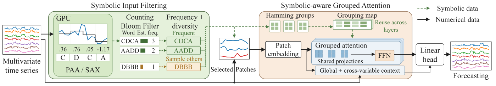
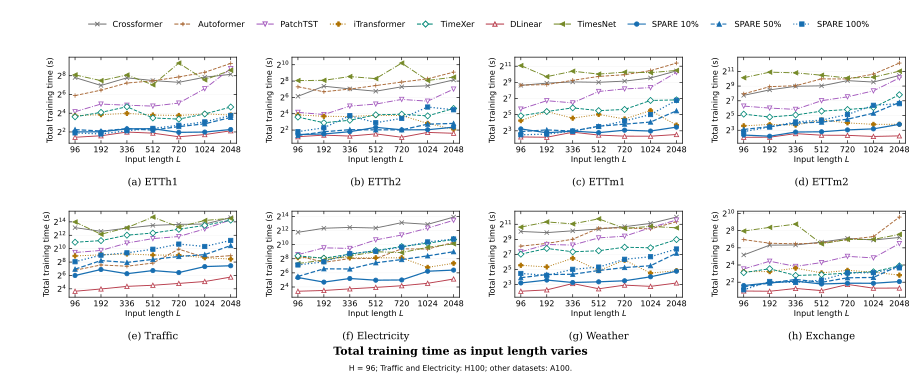

# SPARE

Official GitHub repository for SPARE.

## Overall Framework



Symbolic input filtering selects representative raw patches using frequency and
diversity. Symbolic-aware grouped attention processes their numerical embeddings
in size-constrained groups. Dashed arrows carry symbolic data; solid arrows carry
numerical data used by the forecasting network.

## Training Cost



Total training time versus input length on ETTh1, ETTh2, ETTm1, ETTm2, Traffic,
Electricity, Weather, and Exchange. The prediction horizon is 96; SPARE retains
10%, 50%, or 100% of the patches. The vertical axis shows total training time in
seconds on a base-two logarithmic scale, not individual training-step latency.
All methods use the same GPU model within each dataset. This is the manuscript's
existing result figure, not a new measurement from the portable training entry point.

## Layout

```text
spare-code/
  README.md
  requirements.txt
  requirements-cuda.txt
  train.py
  figures/                 # Overview and training-cost figures, SVG/PDF
  configs/
    benchmarks.json        # Presets for eight datasets
    dataset_hashes.json    # Optional checks against the original local CSVs
  spare/
    model.py               # Numerical forecasting model
    policy.py              # CPU reference policy and optional CUDA policy
    offline.py             # Per-window selection/group metadata cache
    execution.py           # Existing attention execution options
    data.py                # ETT and chronological custom-data splits
    resident_data.py       # Exact windows from device-resident arrays
    timefeatures.py        # Calendar features
    training.py            # Portable fresh-training driver
    verification.py        # Cached/uncached numerical equivalence gate
    kernels/
      selector.py          # Stateless fused CBF-equivalent selector
      fused_routing.py     # Matrix-free capacity-constrained Hamming grouping
  tests/
```

No datasets, checkpoints, job logs, or cluster credentials are bundled.
Other forecasting baselines are not included in this package.

## Environment

Use Python 3.10 or newer. Run commands from this directory.

```bash
python -m pip install -r requirements.txt
python -m unittest discover -s tests -v
```

For the fused backend, use Linux with an NVIDIA GPU and a compatible CUDA-enabled
PyTorch/Triton pair:

```bash
python -m pip install -r requirements-cuda.txt
```

The original frozen GPU execution pilot used PyTorch 2.2.1+cu121 and Triton 2.2.0.
The CPU oracle does not import Triton and can run on macOS or Linux. A new GPU,
PyTorch, or Triton combination still needs its own correctness/performance checks;
installing the requirements is not a benchmark validation.

## Data

Supply the benchmark CSVs separately under a data directory:

```text
data/
  ETTh1.csv
  ETTh2.csv
  ETTm1.csv
  ETTm2.csv
  traffic.csv
  electricity.csv
  weather.csv
  exchange_rate.csv
```

Exact filenames are specified in `configs/benchmarks.json`. CSVs must have a `date`
column and the preset's variable count. Custom datasets also require the original
target column `OT`; it is moved to the last position as in the frozen loader.
ETT uses the original fixed chronological boundaries. Other datasets use 70/10/20
chronological splits. Scaling is fitted on training data only. The loader supports
multivariate forecasting, calendar features, and no augmentation.

`--verify-data` additionally requires the raw CSV hash stored in
`configs/dataset_hashes.json`. Without it, the input hash is still recorded, but a
different CSV is not represented as the original benchmark file.

## Training

### Offline metadata, numerical training only

```bash
python train.py --dataset Weather --data-root ./data \
  --length 512 --horizon 96 --retention 0.5 \
  --mode offline --backend fused --device cuda \
  --batch-size 32 --preprocess-batch-size 8 \
  --output runs/weather_L512_H96_r50_offline
```

SAX, CBF frequency estimates, selection, and grouping are computed once for each
window in each split. Cached indices and group maps are reused across epochs.
Only historical inputs guide preprocessing; future targets do not guide selection.
The numerical network still reads the raw retained patches and full-window context.
Embeddings, attention outputs, activations, and gradients are not cached.

A pre-training gate compares cached execution with the same weights and fixed
metadata in training and evaluation modes. Predictions must match exactly; input
and parameter gradients use `rtol=1e-5, atol=1e-7`. The gate is outside training time.

### Online comparison

```bash
python train.py --dataset Weather --data-root ./data \
  --length 512 --horizon 96 --retention 0.5 \
  --mode online --backend fused --device cuda \
  --batch-size 32 --output runs/weather_L512_H96_r50_online
```

Online mode recomputes symbolic selection and grouping inside the forward pass.
Offline mode fixes each window's diversity draw; online mode advances draws on
visits. Their training trajectories are therefore not claimed to be identical.
Do not copy old online MSE/MAE into a new offline run.

### CPU smoke test

```bash
python train.py --dataset Weather --data-root ./data \
  --length 96 --horizon 96 --retention 0.1 \
  --mode offline --backend reference --device cpu \
  --d-model 16 --d-ff 32 --heads 2 --layers 1 --batch-size 4 \
  --smoke --output runs/weather_cpu_smoke
```

Smoke mode trains two batches for two epochs and evaluates two batches per split.
Offline metadata is still prepared for every window. It produces
`status: smoke_complete`; it is not a full accuracy or efficiency result.

## Defaults and outputs

- Presets retain the existing dataset-specific architecture and learning rate;
  seed 2021, at most 30 epochs, and patience 5 are the campaign defaults.
- Retention supports 10%, 50%, and 100%. The kept patch count uses integer rounding,
  so the actual ratio can differ slightly for short inputs.
- `--batch-size` is explicit. Preset batch sizes are initial settings, not claimed
  to be the previously auto-tuned batch plans or to guarantee 85% GPU utilization.
- The numerical context branch preserves the existing backbone's convention:
  it reads all input variables except the last, plus calendar features. All
  variables receive predictions.
- The fused implementation supports alphabet size 4, four-symbol SAX words, a
  256-counter CBF, at most four groups, three medoid updates, and at most 256
  retained patches. The CPU reference policy is for correctness, not speed claims.
- `--execution all_math_singleton` uses the existing math-attention/singleton
  execution path. `--execution native` keeps the model's SDPA path.
- Every run requires a new output directory; no old run is overwritten or resumed.

Each output directory contains `result.json` and the validation-selected
`best.pth`. Results record configuration, CSV/source hashes, environment, split
sizes, epoch history, test MSE/MAE, and per-epoch training-phase CUDA peak allocated
memory when available (not a peak over preprocessing, validation, and final test).
MSE/MAE are elementwise means in the standardized benchmark space.

Time fields are wall-clock measurements, synchronized on CUDA:

| Field | Boundary |
| --- | --- |
| `preprocessing_seconds` | Offline data loading, symbolic processing, selection/grouping, cache construction, and first-use discrete compilation; zero in online mode |
| `training_seconds` | Fresh numerical model, loaders, and Adam construction through validation early stopping or the epoch cap; includes validation, checkpoint writes, cache reads, and first-use numerical compilation |
| `preprocessing_plus_training_seconds` | Sum of the two fields above |
| `verification_seconds_excluded` | Offline cache correctness gate, when applicable |
| `final_test_seconds_excluded` | Final evaluation using the validation-selected checkpoint |

In online mode, symbolic processing is included in `training_seconds`. Offline
preprocessing cleanup and Python garbage collection between stages are not included
in either main clock. Queueing, package imports, CUDA initialization, and batch-size
search are outside both clocks. This portable driver is a new entry point: its
timings are not relabeled measurements from the earlier cluster campaign.

## Scope

This is a source-code organization and portability release, not confirmation that
all manuscript claims have been reproduced. Existing kernels/model math are carried
over, while the self-contained training driver is newly assembled and tested
locally. Full GPU training and paper comparisons must be rerun and audited using
the intended data, settings, hardware, and stopping rule.

## Source Notices

Dataset loading is adapted from the frozen forecasting benchmark loader.
`spare/timefeatures.py` retains its original GluonTS-derived copyright and
Apache License 2.0 notice. Preserve these embedded notices when redistributing
the source files.
